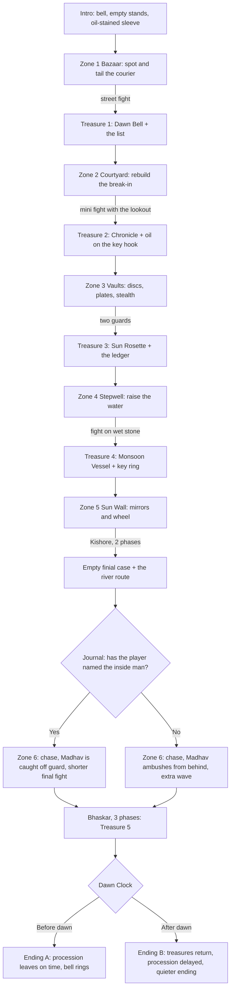

# Legacy of the Temple — V3 story line-up

A short thriller told mostly without words. Everything here is fiction: the village of Suryapur, the temple's treasures and every character. No real deity is shown, carried or stolen. The shrine idol stays a respectful background element and is never part of the theft.

## One-line pitch
Five treasures vanish from a temple storeroom the night before its festival. Investigator Aryan has until dawn to take them back, one robber at a time, and to find out who opened the door from the inside.

## The hook (first 60 seconds, no speech)
Night. A bell on a thread rings once in the dark storeroom. Five cloth-lined stands, then five empty stands. Two figures run. A third hand, seen only as a sleeve with a lamp-oil stain, pulls the storeroom door shut and turns the key. Cut to a jeep on a village road at first light.

## The ticking clock
The Dawn Clock. The festival procession leaves the gate at dawn, and the buyer's boat leaves the river ghat at the same moment. Every zone costs time; hints cost time; fast travel costs time. When the clock runs out the game does not end, but the ending changes (see Endings).

## Cast (existing models only)
| Character | Model | Role |
|---|---|---|
| Aryan | Investigator | The player. Speaks very little. |
| Pujari Ananda | Priest | Head priest. Frightened, honest. |
| Meera | Villager (saree) | Tea-lane girl. Saw two men. Notices what others miss. |
| Bhaskar | Robber 1 | The leader. Carries the fifth treasure. Final fight. |
| Kishore | Robber 2 | The planner. Mini boss at the Sun Wall. |
| Robber variants | Robber 1 and 2 recoloured and resized | Courier, lookout, vault guards, knife man, final waves. |
| Madhav, the key-keeper | Male villager | The inside man. Friendly and helpful all game. |

## The five treasures (all fictional)
| # | Treasure | Carried by | Zone |
|---|---|---|---|
| 1 | The Dawn Bell, a small brass hand bell | The courier | Bazaar and Tea Lane |
| 2 | The Palm-Leaf Chronicle, a bound manuscript | The lookout | Temple Gate and Courtyard |
| 3 | The Sun Rosette, a carved sandstone disc | Two vault guards | Underground Vaults |
| 4 | The Monsoon Vessel, a silver water pot | The knife man | Stepwell and Monsoon Shrine |
| 5 | The Chariot Finial, a gold wheel-shaped finial | Bhaskar | Jungle Road and Ruins (its empty case and the route are found at the Sun Wall) |

## The twist: the inside man
Nobody tells the player. Four pieces of evidence, one per zone, sit in the journal as plain observations. When the player has all four, the journal's centre page lets them place the four pieces on one name. Getting it right before the final zone changes the last fight and the ending.

| Zone | What the player finds | What it means |
|---|---|---|
| 1 Bazaar | The courier's note: a list of five items in neat handwriting, with a tick style of two short strokes | Someone who writes lists wrote this |
| 2 Courtyard | The storeroom lock is not forced; the scratches are on the inside. The key hook has fresh lamp oil on it | Opened with the real key by someone who handles lamps |
| 3 Vaults | The vault duty ledger, same handwriting and same two-stroke ticks, signed "M." | The list writer keeps the temple ledgers |
| 4 Stepwell | A dropped key ring with a temple tag and an oil-stained cloth | The key-keeper was here tonight |

Madhav appears in every zone before the reveal doing something ordinary that fits the evidence in hindsight: wiping his hands in the bazaar, hanging keys in the courtyard, "checking the lamps" near the vault stair. He is the one who gives the player the vault lantern.

## Flow

## Endings
- **Ending A (before dawn):** Aryan sets the five treasures on their stands. The Dawn Bell rings. The gate opens on the first sunlight. No speech until the last line.
- **Ending B (after dawn):** the same return, but the crowd has waited in silence and the lamps have burned out. Lower grade, same closing text.
- Closing text on screen: "Every temple holds a story. Every artifact carries a memory. Protecting heritage means protecting our history." Then MISSION COMPLETED with treasures, score, grade and time.

## All spoken dialogue (44 lines; never more than 2 in a row)
Each line is short enough to read at a glance. Numbers are line counts.

**Intro, directions (3)**
1. ARYAN: "Which way to the temple?"
2. MEERA: "Straight on. Through the old stone gate."
3. MEERA: "Hurry. They are frightened."

**Zone 1, Bazaar (7)**
4. PUJARI: "Five treasures. Gone before sunrise."
5. PUJARI: "The procession leaves at dawn."
6. MEERA: "Two men. One carried a bell."
7. MEERA: "It rang. He hid it fast."
8. MADHAV: "Tea, sir? You look tired."
9. COURIER (cornered): "You followed me? Clever."
10. ARYAN (after the fight): "One. Four to go."

**Zone 2, Courtyard (6)**
11. PUJARI: "Nothing was touched. I swear it."
12. MADHAV: "I locked up myself. As always."
13. ARYAN (at the lock): "Not forced. Opened."
14. LOOKOUT: "You should have stayed in the village."
15. ARYAN (after): "Two."
16. PUJARI: "The old vaults. Under the hall."

**Zone 3, Vaults (6)**
17. MADHAV: "Take my lantern. It is dark below."
18. GUARD (patrol, overheard): "He said nobody comes down here."
19. GUARD: "He said a lot of things."
20. GUARD (alerted): "Light! Someone's here!"
21. ARYAN (after): "Three."
22. ARYAN (ledger): "M."

**Zone 4, Stepwell (6)**
23. MEERA: "They went to the old well. In this rain."
24. KNIFE MAN: "Slippery, isn't it?"
25. KNIFE MAN (losing): "He promised us a boat!"
26. ARYAN (after): "Four."
27. ARYAN (key ring): "Temple keys. Out here."
28. MEERA: "Only one man carries those."

**Zone 5, Sun Wall (6)**
29. KISHORE: "You read the wall. Impressive."
30. KISHORE: "The finial is already moving."
31. KISHORE (phase 2): "Bhaskar will not wait for me."
32. KISHORE (down): "The river. Before dawn."
33. ARYAN: "An empty case."
34. ARYAN: "The jungle road. Now."

**Zone 6, Jungle and Ruins (10)**
35. BHASKAR: "Keep moving. He is close."
36. MADHAV (if the player named him): "You knew?"
37. ARYAN (if named): "Your handwriting. Your keys."
38. MADHAV (if not named, from behind): "I am sorry, sir."
39. BHASKAR: "Do you know what this fetches?"
40. ARYAN: "Its value is not money."
41. BHASKAR (phase 3): "Then come and take it."
42. ARYAN (after): "Five."
43. MADHAV (caught): "I only opened a door."
44. PUJARI (ending): "You brought our memory home."

Budget check: 44 lines, longest run 2, average about 5 words.

## Environmental storytelling (no speech)
- **Notes and paper:** the courier's list; a torn festival poster with the dawn time circled; the vault duty ledger; a buyer's receipt with a boat drawn on it; a child's chalk drawing of "two men and a bell" on a bazaar wall.
- **Photographs:** a framed photo in the priest's room of last year's procession with all five treasures on show (the player learns what to look for); the same photo has Madhav at the edge holding the keys.
- **Objects:** five empty cloth-lined stands, each with a dust outline of its treasure; a bell thread cut clean; a broken oil lamp and its spill; muddy prints of two boot sizes and one bare sandal; a rope and pulley left at the stepwell; cart tracks leaving the Sun Wall.
- **Sound:** the Dawn Bell rings faintly whenever the courier jostles it (the tailing puzzle is partly by ear); water rising in the stepwell; a boat engine far off that gets louder as dawn nears.
- **Silent cutscene shots (3 to 6 seconds each):** the oil-stained sleeve at the door; Madhav wiping his hands when Aryan looks away; the boat lamp on the river.

## What happens to the old story content
The old 24-step objective list, the long courtyard, sanctum and shrine conversations and the press-E clue objects are replaced by this document. Old files are kept in git history (tag `backup-v3-start`).
